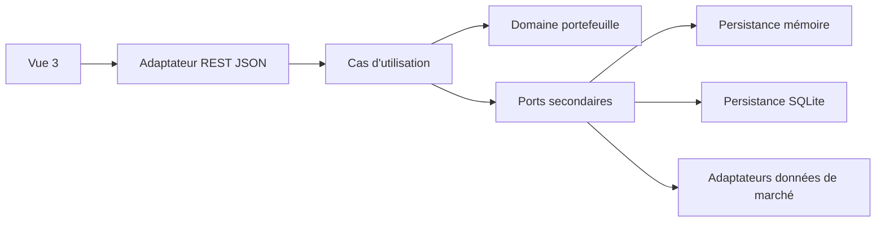
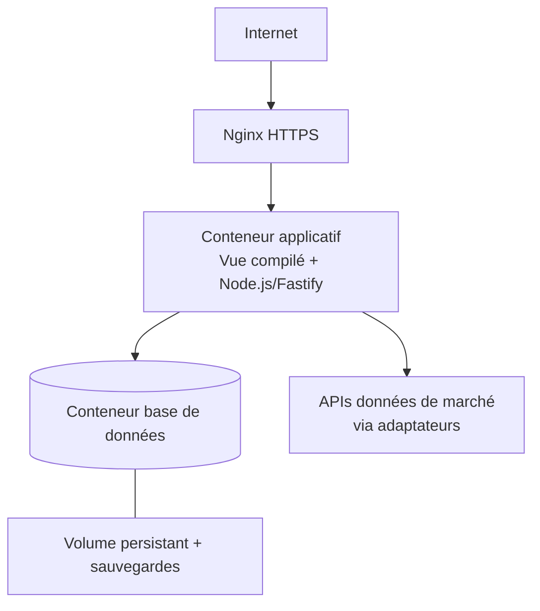

# Architecture Spine — Portif Bourse

## Design Paradigm

Portif Bourse suit une architecture hexagonale. Le cœur contient le domaine et les cas d'utilisation. Les adaptateurs entrants exposent l'API REST et l'interface web ; les adaptateurs sortants implémentent la persistance et les fournisseurs de données. Les dépendances pointent vers le cœur, jamais l'inverse.



## Invariants & Rules

### AD-1 — Cœur métier indépendant des frameworks

- **Binds:** toutes les capacités V1
- **Prevents:** des cas d'utilisation couplés à Vue, Fastify, SQLite, PostgreSQL, un ORM ou un fournisseur externe
- **Rule:** le domaine et les ports sont écrits en TypeScript pur ; les frameworks et infrastructures ne sont référencés que dans les adaptateurs et le câblage.

### AD-2 — Ports secondaires orientés domaine

- **Binds:** R1, R2, R4, R9, R12, R13, R14, R15
- **Prevents:** un port générique de type CRUD qui rendrait chaque adaptateur dépendant d'un modèle de stockage différent
- **Rule:** les ports expriment des besoins métier tels que transactions, liquidités dérivées, positions, cours et taux ; aucun port ne révèle SQL, ORM ou document NoSQL.

### AD-3 — Transactions comme source de vérité

- **Binds:** R1, R4, R6, R13, R14, R15
- **Prevents:** divergence entre un registre d'opérations, un solde de liquidité et une position persistée
- **Rule:** les apports et achats V1 sont enregistrés comme transactions ; la liquidité et les positions sont recalculées à partir de leurs effets. Les retraits et ventes sont réservés aux versions futures.

### AD-4 — Mutation atomique du portefeuille

- **Binds:** R1, R4, R14, R15
- **Prevents:** un achat enregistré sans débit de liquidité, ou un débit sans transaction correspondante
- **Rule:** l'enregistrement d'un achat et son effet sur les liquidités sont validés ou annulés ensemble dans une même transaction technique.

### AD-5 — Valeurs financières décimales et dates explicites

- **Binds:** R1, R6, R9, R14, R15, R16
- **Prevents:** erreurs de flottants, arrondis implicites et ambiguïtés de fuseau
- **Rule:** les valeurs financières utilisent un décimal exact avec jusqu'à huit décimales en V1 ; le code devise accompagne chaque montant ; les dates métier sont calendaires sans heure ; les horodatages techniques sont en UTC.

### AD-6 — Conversion historique conservée

- **Binds:** R9, R15, R16
- **Prevents:** impossibilité de reproduire le montant normalisé d'une transaction étrangère
- **Rule:** une transaction étrangère conserve son montant et sa devise d'origine, son montant dans la devise par défaut, le taux appliqué et la date de conversion.

### AD-7 — Contrat REST JSON

- **Binds:** toutes les capacités exposées au frontend
- **Prevents:** le frontend dépendant directement des objets ou modules du backend
- **Rule:** Vue 3 communique avec Fastify uniquement par l'API REST JSON ; les routes restent des adaptateurs qui délèguent aux cas d'utilisation.

### AD-8 — Déploiement frontal et conteneurisé

- **Binds:** tous les epics en environnement serveur
- **Prevents:** exposition publique de la base ou déploiements impossibles à reproduire
- **Rule:** Nginx termine HTTPS et relaie vers un conteneur applicatif unique contenant frontend compilé et backend Node.js/Fastify ; la base est dans un conteneur séparé sur un réseau privé, avec volume persistant et sauvegarde avant production.

### AD-9 — Accès public sans authentification en V1

- **Binds:** C2, déploiement V1
- **Prevents:** une authentification implicitement supposée par les composants
- **Rule:** la V1 de test peut être exposée publiquement derrière HTTPS sans authentification applicative ; ce risque accepté doit être réévalué avant toute donnée sensible ou tout passage au multi-utilisateur, et l'absence de contrôle d'accès bloque la déclaration production-ready.

### AD-10 — Séparer registre, coût d'acquisition et valorisation courante

- **Binds:** R3, R4, R10, R11, R16
- **Prevents:** confondre une valeur issue des transactions avec une valeur issue d'un cours courant
- **Rule:** le registre fournit les liquidités, quantités et coûts d'acquisition dérivés ; la valeur courante et la performance combinent ces éléments avec le dernier cours et le dernier taux de change disponibles. Cette valorisation est une vue de lecture reconstruisible, avec la date des données utilisées et un signal de fraîcheur.

### AD-11 — Contrat commun des adaptateurs de persistance

- **Binds:** R1, R4, R6, R13, R14, R15
- **Prevents:** adaptateurs mémoire, SQLite et futur moteur serveur qui appliquent des règles différentes
- **Rule:** les adaptateurs partagent des tests de contrat couvrant atomicité, idempotence, ordre déterministe, reconstruction du registre, persistance et réutilisation des observations de cours/FX après redémarrage. Les transactions de schéma sont versionnées et exécutées par l'adaptateur de persistance.

### AD-12 — Contrat canonique des instruments, cours et taux

- **Binds:** R2, R3, R7, R8, R9, R10, R12, R16
- **Prevents:** instrument ambigu, taux inversé ou cours périmé utilisé sans signal
- **Rule:** tout instrument identifié conserve ticker, place, nom, type, devise de cotation et identifiant source ; tout cours conserve date de marché, devise, valeur, source et horodatage de récupération ; tout taux conserve paire orientée, valeur, date effective, source et horodatage. Les fournisseurs externes sont adaptés vers ce modèle canonique.

### AD-13 — Données externes résolues avant la mutation atomique

- **Binds:** R9, R14, R15
- **Prevents:** appel réseau bloqué dans une transaction d'écriture ou conversion non reproductible
- **Rule:** le taux historique requis est résolu et validé avant l'ouverture de la mutation atomique ; l'écriture persiste le taux, sa source et sa date effective. Aucun appel fournisseur externe ne se déroule dans la transaction de persistance.

## Consistency Conventions

| Concern | Convention |
| --- | --- |
| Nommage | Types et cas d'utilisation en anglais technique stable ; termes métier alignés sur portefeuille, transaction, instrument, cours, taux et devise. |
| Identifiants | Identifiants opaques générés côté backend ; le format précis est à fixer lors du scaffold. |
| Données financières | Décimales exactes, jusqu'à huit décimales ; jamais de flottant binaire pour les montants, prix, quantités ou taux. |
| JSON | Les valeurs décimales sont sérialisées comme chaînes JSON canoniques sans perte de précision ; les schémas REST sont versionnés. |
| Dates | Date métier `YYYY-MM-DD` ; horodatage technique UTC ; ordre intrajournalier réservé à une évolution future. |
| Erreurs | Les cas d'utilisation retournent des erreurs métier distinctes des erreurs d'adaptateur ; l'API les mappe en réponses HTTP JSON. |
| Configuration | Fournisseurs, URLs, secrets et chemins de données viennent de la configuration d'environnement, jamais du domaine. |
| Tests | Les cas d'utilisation sont testés avec l'adaptateur mémoire ; la même suite de contrat est rejouée sur SQLite puis sur le moteur serveur retenu. |
| Données externes | Une donnée absente, périmée ou un fournisseur indisponible est distingué et visible ; aucune valeur de remplacement silencieuse n'est autorisée. |

## Stack

| Name | Version |
| --- | --- |
| Node.js | 24 LTS |
| TypeScript | 7.x |
| Vue | 3.x |
| Fastify | 5.x |

## Structural Seed

```text
src/
  domain/                 # entités, objets-valeurs, règles métier
  application/            # cas d'utilisation et ports
  adapters/
    inbound/http/         # routes REST Fastify et schémas JSON
    outbound/persistence/ # mémoire, SQLite, puis moteur serveur à choisir
    outbound/market-data/ # recherche, cours, historiques et FX
  infrastructure/         # composition, configuration, serveur
  frontend/               # application Vue 3 compilée
```



## Capability → Architecture Map

| Capability / Area | Lives in | Governed by |
| --- | --- | --- |
| R1, R6, R13, R14, R15 — transactions et liquidités | `domain/`, `application/`, port de persistance | AD-1, AD-2, AD-3, AD-4, AD-5, AD-6, AD-11, AD-13 |
| R2, R7, R8, R9, R12 — instruments, cours et devises | cas d'utilisation + port `MarketDataProvider` + adaptateurs externes | AD-1, AD-2, AD-5, AD-6, AD-12, AD-13 |
| R3, R4, R10, R11, R16 — valorisation et vues | cas d'utilisation de lecture + API REST + frontend Vue | AD-3, AD-5, AD-7, AD-10, AD-12 |
| Déploiement V1 | Nginx, conteneur applicatif, conteneur base | AD-8, AD-9 |

## Test & Operations Envelope

- Tests unitaires du domaine avec l'adaptateur mémoire.
- Tests de contrat du port de persistance sur mémoire et SQLite, puis sur le moteur serveur retenu.
- Tests d'intégration REST avec Fastify et tests de reconstruction après redémarrage.
- Tests de données externes avec fournisseurs simulés, données périmées, absence de taux et erreur réseau.
- Le conteneur applicatif expose un endpoint de santé ; Nginx ne publie que l'application et l'API, jamais la base.
- Les images, dépendances et lockfiles sont verrouillés au scaffold ; les migrations sont exécutées explicitement et les sauvegardes sont restaurables avant la production.

## Deferred

- Moteur de base de données des environnements serveur : PostgreSQL est candidat ; NoSQL reste possible après étude des accès et de la cohérence, sans décision silencieuse.
- Même si le moteur serveur reste ouvert, la V1 exige une persistance transactionnelle et un mécanisme de migrations versionnées compatibles avec le contrat de persistance.
- Fournisseurs de recherche de ticker, cours, historiques et taux EUR/USD ; couverture, quotas, licences et conditions d'utilisation nécessitent un spike.
- Politique de rafraîchissement, cache, données manquantes et corrections de cotations ; à décider avec le spike de données de marché.
- Calendrier de marché et règle exacte des deux jours ouvrés pour signaler un cours périmé ; à fixer dans l'Epic 3 avec le contrat de données de marché.
- Framework de build frontend précis et format final de sérialisation décimale JSON ; à fixer au scaffold Vue 3, avec décimales transmises en chaîne et un schéma JSON versionné.
- Politique exacte d'arrondi et échelle de chaque champ décimal ; à fixer dans une politique monétaire partagée avant les stories d'écriture.
- Règle d'un achat lorsque la liquidité dérivée est insuffisante, ainsi que la clé d'idempotence des écritures HTTP ; à décider avant la story d'achat.
- Authentification applicative ; absente de la V1, qui reste un environnement public à risque accepté et ne doit pas être déclarée production-ready sans contrôle d'accès ou limitation réseau.
- Limitation de débit, taille maximale des payloads, renouvellement des certificats, secrets, logs et procédure de restauration ; à fixer avant le premier déploiement public.
- Retraits de liquidité, ventes et opérations intrajournalières ; versions futures.
- UX détaillée, états d'écran et accessibilité ; à produire avec Sally avant l'implémentation des stories d'interface.
